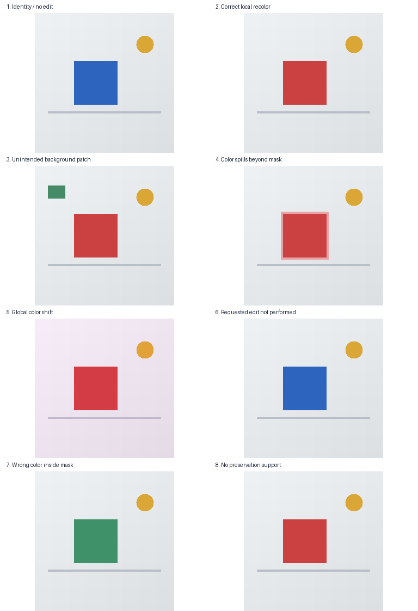

# Image preservation controls

Eight small procedural controls illustrate the difference between background
preservation and instruction success. **These are synthetic controls, not outputs of
an image generative model, a real-photo benchmark, or human-validated examples.**



The contact sheet displays edited images only; original images and explicit masks
are available through [manifest.json](manifest.json). Every sample shares
`source_group_id: geometric-scene-01`: the collection is one source group, not eight
independent observations. Do not split its variants across study partitions.

## Cases and expected behavior

All images are 256 x 256 RGB PNGs. Masks are 8-bit grayscale PNGs: `255` permits an
edit and `0` denotes the preservation region. The normal mask covers rows `[88,168)`
and columns `[72,152)`: 6,400 edit pixels and 59,136 preservation pixels.

| Sample ID | Construction | Expected preservation | Instruction interpretation |
| --- | --- | --- | --- |
| `identity` | Exact original copy; instruction requests no change | Exact match | No change requested |
| `local-recolor` | Blue square changed to red only inside mask | Exact match | Intended procedural edit |
| `outside-patch` | Local recolor plus 32 x 24 background patch | 768 outside pixels changed | Unintended extra edit |
| `boundary-spill` | Local recolor plus four-pixel outer rectangular band | 1,344 outside pixels changed | Boundary spill outside permission |
| `global-color-shift` | Local recolor plus RGB offset `(8,-5,3)` across image | Every preservation pixel changed | Background changed globally |
| `unchanged-failed-edit` | Exact original copy despite recolor instruction | Exact match | Requested recolor not performed |
| `wrong-local-color` | Square changed to green instead of red | Exact match | Requested color not produced |
| `no-preservation-support` | Local recolor with all-255 mask | Not applicable | No preservation evidence available |

These expectations describe known construction, not computed evaluator results or
independent human labels. MAE/PSNR should recognize exact outside-mask equality for
the appropriate cases. SSIM also requires valid windows wholly outside the mask.
The full-mask case must never be reported as perfect preservation.

`identity` and `unchanged-failed-edit` intentionally have identical pixels but different
instructions. They demonstrate why preservation alone cannot measure editing success.
Duplicate content is deliberate, not additional independent evidence.

## Provenance and reuse

The original scene, masks, and edits are constructed locally from coordinate arrays
and simple geometric regions by [create_controls.py](create_controls.py). There are
no external source images or model weights. `generator` is null on every record.

Fixture image reuse is permitted under the scoped [permission notice](LICENSE.txt),
referenced as `LicenseRef-Demo-Fixtures` in each sample. This is a local license
reference, not an SPDX-listed license or a license for the entire repository.

No real generated-image pairs are included. The controls establish known behaviors
and support visual demonstrations; they cannot establish performance on model outputs.

## Reproduce

From the repository root, using the installed environment:

```powershell
.\.venv\Scripts\python.exe examples/images/create_controls.py
```

The script overwrites this directory's generated PNGs and manifest with deterministic
constructions. Pixel values are fixed; byte-for-byte PNG reproduction depends on the
Pillow/compression environment. The tested dependency snapshot is in
[the Windows CPU lock](../../requirements/windows-cpu-py312.lock.txt).

The manifest follows the [image evaluation contract](../../docs/image-evaluation.md).
It points to existing assets; [the separate format example](../image-manifest.example.json)
still uses illustrative paths and is not a dataset.
